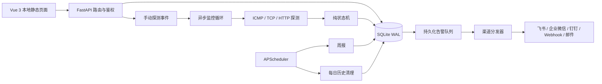
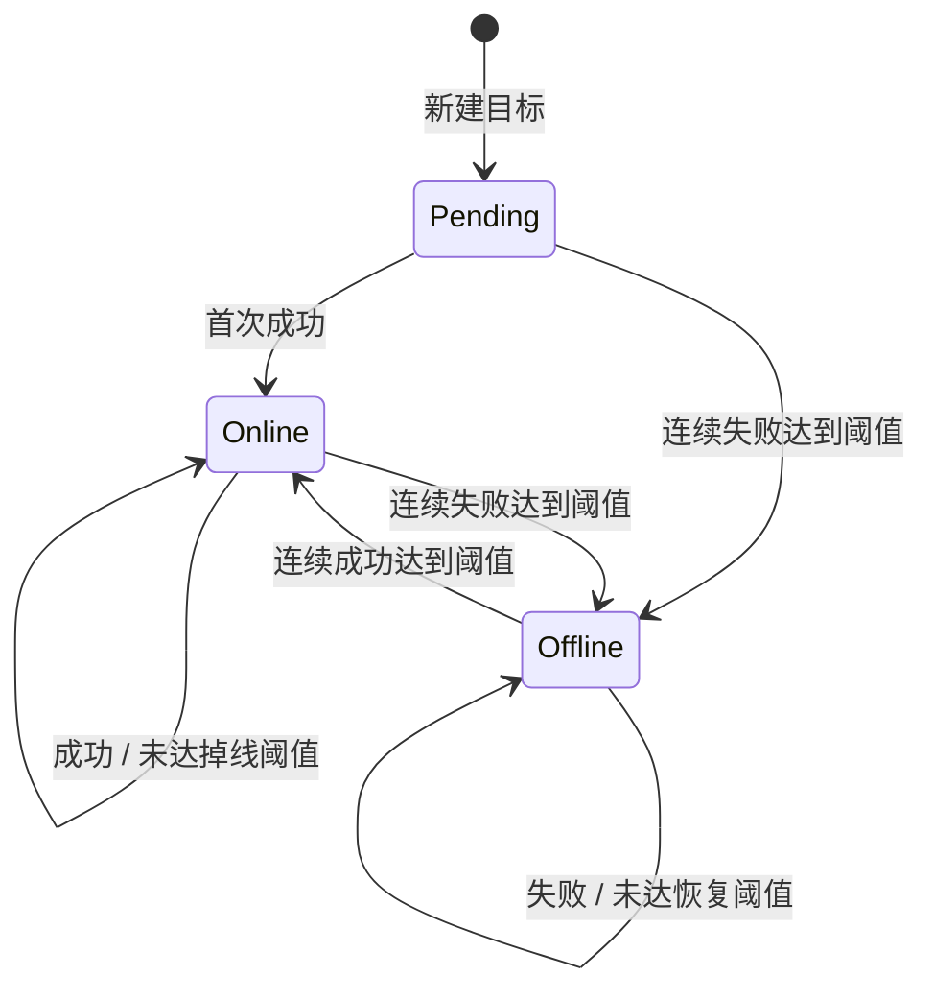

# 架构与数据流

本文替代根目录的历史白皮书描述，依据当前 `main.py`、`engine.py`、`alert.py`、`models.py` 与 `services/` 整理。目标是单实例、单 worker、SQLite 单文件部署；不承诺多进程协调或分布式高可用。

## 设备身份与状态

一台设备记录代表一个探测目标。组合 `(ip_address, probe_type, probe_port, probe_path)` 唯一；同一地址可监控多个端口或路径。业务状态、连续成功/失败次数、最近探测与错误持久化在 `devices`；`alert_logs` 保存状态变更历史，不再承担当前状态的唯一来源。

维护、暂停、停止是监控控制状态，不与上图的在线/离线事件混为一谈。维护期间继续探测并记录状态，但抑制通知；暂停和停止不参加探测。首次成功可立即确认为在线；其后仅真实状态跃迁才产生告警。前端另外将尚未达到阈值的失败显示为“疑似异常”，并标记过期探测数据。

## 探测与告警

监控循环按设备周期选择到期目标，默认并发上限 50。ICMP 子进程有超时和回收；TCP 和 HTTP 使用异步网络调用。一次失败可按设备配置快速重试，再交给纯状态机。状态、事件和告警待发送项在同一数据库事务中提交；分发器逐渠道记录投递结果，失败指数退避，达到上限后留在死信状态。批量离线事件可在短窗口内合并发送。

## 存储、时间与迁移

SQLite 启用 WAL、`synchronous=NORMAL`、外键和 5 秒忙等待。时间在数据库与 API 使用 UTC 且带时区；浏览器按用户本地时区显示。启动时先对需要迁移的既有数据库执行 SQLite 在线备份，再升级到 Alembic head。升级前、恢复前备份按各自前缀保留最近 N 份。每日保留策略分批清理历史，且保留每台设备最新一条状态事件。

数据库上传恢复会暂停监控和告警任务、验证 SQLite 完整性与表结构、在同一数据目录原子替换，并在失败时尝试恢复前备份。操作步骤见 [运维手册](operations.md)。

## 安全边界

`/api/*` 除登录外使用 Bearer 令牌；viewer 只有读取权限。签名、渠道密钥加密使用 `APP_SECRET`。通知目的地默认禁止内网、回环和元数据地址；被监测设备仍可位于内网。前端 Vue 生产版随项目提供，页面有 CSP 与安全响应头。系统应放在 HTTPS 反向代理后运行，并保持单 worker。
